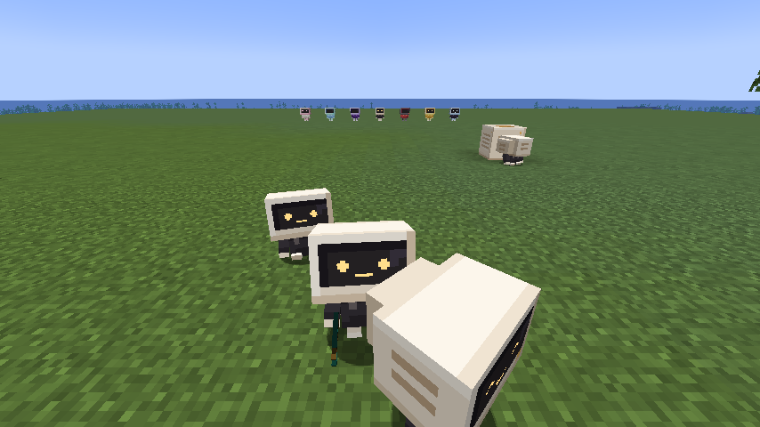
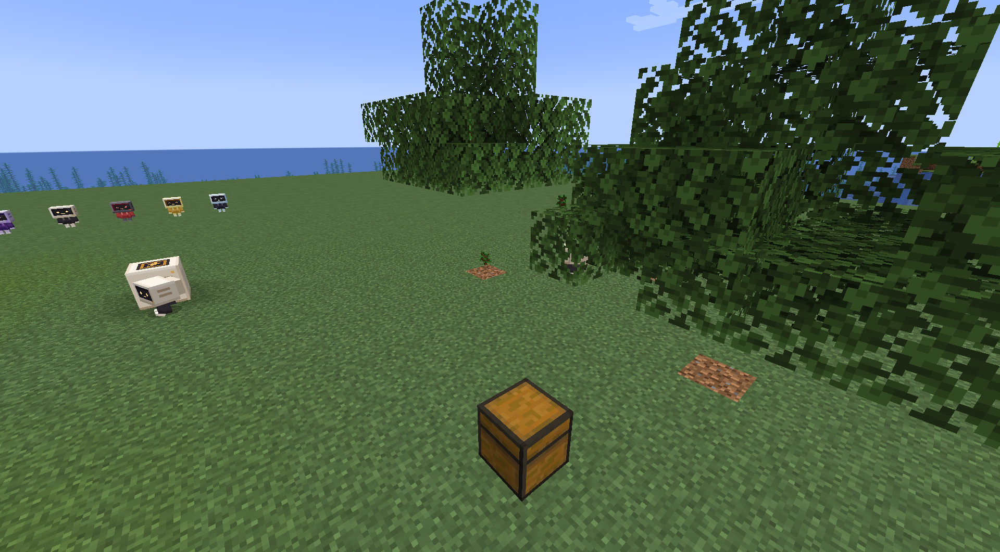
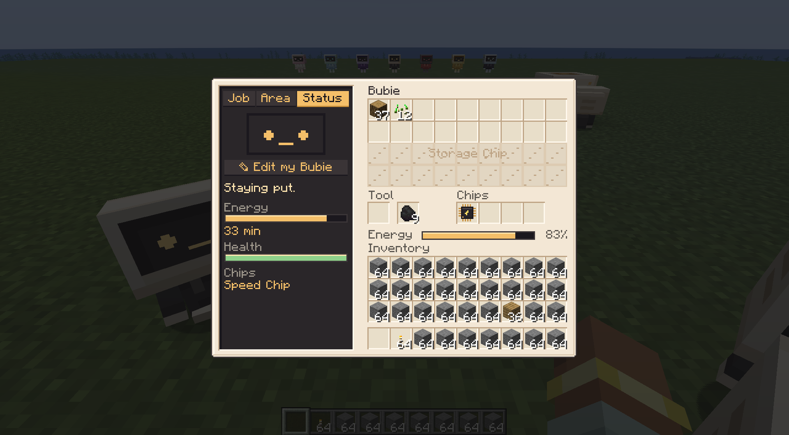
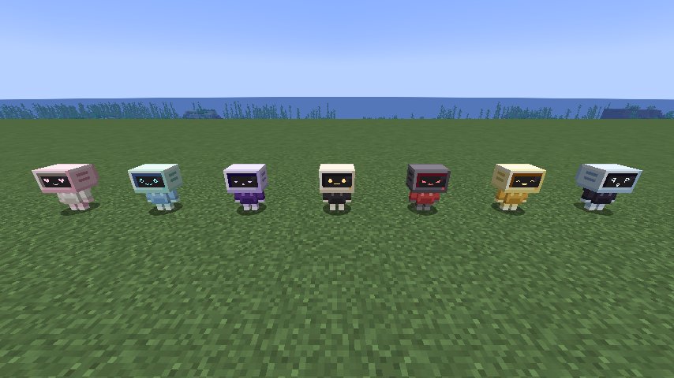
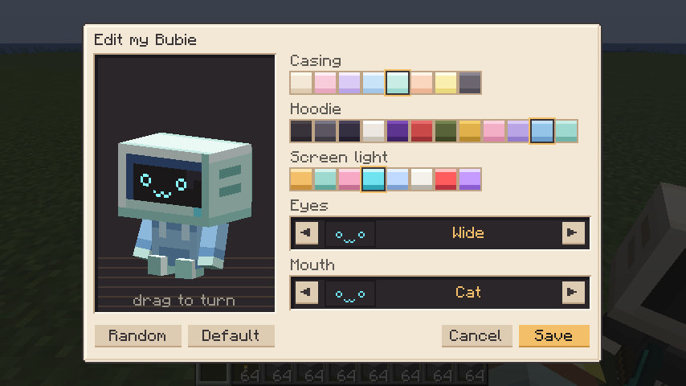
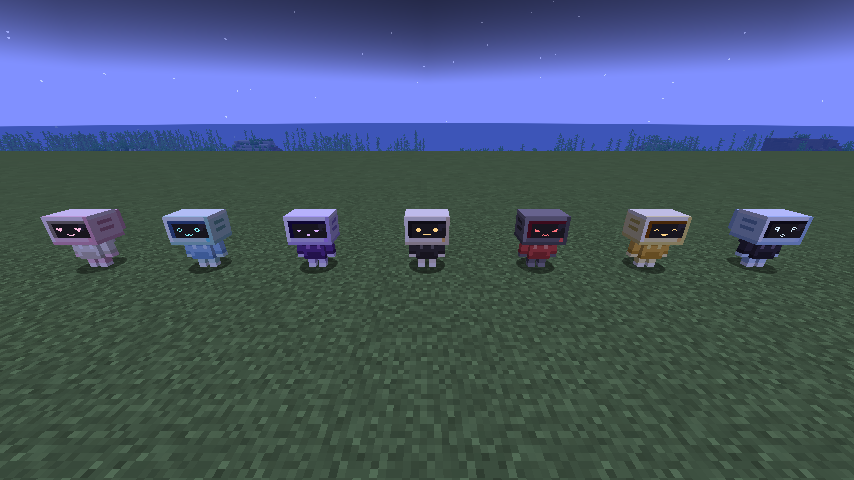

# Bubie

Mod para **Minecraft 1.21.1 (NeoForge 21.1.265)**, feito para o Bubie Pack. O Bubie é um robozinho
(tela CRT creme, olhos âmbar, moletom preto) como ajudante: segue você, carrega itens e, com uma tarefa e uma
área, coleta recursos sozinho e guarda tudo num baú.

## Imagens
| | |
|---|---|
|  |  |
|  |  |
|  |  |
|  | |

## Editar meu Bubie
Na aba **Status** do menu, **✎ Editar meu Bubie** abre o editor de visual dentro do jogo: cor do casco,
do moletom e da luz da tela, olhos e boca, com prévia girando (arraste para virar), **Aleatório** e **Padrão**.
As paletas e as peças de rosto são as do site (`features/my-bubie/manifest.ts`, `public/my-bubie/v1`), menos as cores do Plus.
A aparência fica salva no Bubie (e no item, quando ele é guardado ou desliga) e todos no servidor veem igual.
As expressões automáticas (feliz, trabalhando, erro, dormindo, machucado) aparecem por cima e voltam para o rosto escolhido.

| | |
|---|---|
|  |  |
|  |  |

## Receitas
| Item | Receita |
|---|---|
| **Bubie** | cobre, vidro, cobre / cobre, redstone, cobre / _, lã preta, _ |
| **Prancheta do Bubie** | _, redstone, _ / papel, graveto, papel / papel, papel, papel |
| **Estação do Bubie** | cobre, vidro, cobre / redstone, baú, redstone / ferro, ferro, ferro |
| **Chips** | pepita de ouro e redstone em volta de: açúcar (velocidade), baú (armazenamento), bússola (alcance), funil (ímã), alto-forno (fundição), bloco de cobre (eficiência) |

Um Bubie novo já vem com a energia de dois pós de redstone.

## Como usar
| Ação | O que faz |
|---|---|
| Clique no chão com o item Bubie | Liga o Bubie. Ele passa a ser seu |
| Clique direito no Bubie | Abre o menu: modo, tarefa, área, status e o inventário dele |
| Shift + clique direito com a mão vazia | Guarda o Bubie no seu inventário, com tudo o que ele tem |
| Prancheta: Shift + clique num baú | Marca onde ele guarda as coisas (qualquer bloco com inventário: baú, gaveta, Sophisticated Storage, AE2). **Basta isso**: sem área marcada, ele trabalha em volta do baú |
| Prancheta: clique em 2 blocos | Opcional: marca os cantos de uma área sua (aparece no mundo em âmbar) |
| Prancheta: Shift + clique numa Estação | Marca a casa dele |
| Prancheta: clique no Bubie | Entrega área, baú e casa, e ele começa a trabalhar |
| Prancheta: Shift + clique no ar | Limpa a prancheta |
| Clique no Bubie com um Chip | Instala o chip |

**Onde ele trabalha:** sem área marcada, em volta do baú (ou da Estação, se não tiver baú), num raio que você ajusta
com − e + na aba Área do menu (8 por padrão; Chips de alcance aumentam o máximo). O Lenhador procura as árvores em volta,
o Fazendeiro as plantações, o Minerador os minérios até 24 blocos abaixo, o Guarda os monstros. A Pedreira e o Escavador,
que tiram tudo, abrem um buraco **na frente** do baú (para onde ele está virado), a partir de 2 blocos, e nunca mexem no
chão da base.

**Modos:** Seguir (anda atrás de você e pega itens do chão), Ficar (senta e espera) e Trabalhar.

## Tarefas
| Tarefa | O que faz |
|---|---|
| **Lenhador** | Derruba a árvore inteira de uma vez e replanta a muda da mesma madeira. Não mexe em troncos sem folhas naturais nem em troncos encostados em tábuas, vidro ou baús (casas) |
| **Escavador** | Areia, cascalho, terra e argila, camada por camada (filtros no menu). Não mexe em areia suspeita |
| **Pedreira** | Escava a área inteira em camadas e deixa uma escada em espiral nas paredes. Antes de cavar perto de água ou lava, tampa com pedregulho que ele guarda |
| **Fazendeiro** | Colhe plantações maduras e replanta com as próprias sementes. Também cana, cacto, bambu, abóbora, melancia, cacau, fungo do Nether e frutas silvestres (sem quebrar o arbusto) |
| **Minerador** | Veio: minérios expostos na área (um veio inteiro, bloco a bloco). Túnel: galeria 1×2 no fundo da área com ramificações a cada 4 blocos, pegando todo minério que aparece e pondo tochas. Minérios pela tag `c:ores` (inclui All the Ores) |
| **Coletor** | Junta todos os itens do chão na área |
| **Construtor** (com o mod Base Blueprint) | Configure uma Planta de Base (forma, tamanho, material) e clique no Bubie com ela, onde a base deve ficar: ele constrói bloco por bloco, de baixo para cima, pegando os blocos no baú dele. A porta fica virada para você. Sem material, mostra "Esperando material" (com o bloco e quantos faltam) e continua quando o baú recebe mais, então outro Bubie (um Lenhador ou uma Pedreira) pode abastecer o mesmo baú enquanto ele constrói. O menu e o Jade mostram o progresso (blocos feitos / total). Com a Base Blueprint 1.4.0+, escolha **Quem constrói: Bubie** no menu da planta e clique num bloco: a prévia âmbar mostra onde, e o seu Bubie mais próximo constrói ali. O que ainda falta aparece no mundo como **blocos fantasma**: mire num deles para ver qual bloco vai ali e coloque você mesmo para ajudar, que o Bubie desconta do que falta (`buildGhosts` no `config/bubie-client.toml` desliga) |
| **Guarda** | Enfrenta os monstros que entram na área (ou em volta da Estação) com a arma do slot de ferramenta e junta o que eles largam. Não foge, não descansa à noite e deixa os creepers em paz (acertar um de perto só faz ele explodir na base) |
| **Entregador** | Esvazia os baús, funis e saídas de fornalha da área no baú dele (a fornalha fica com o combustível). Se o baú dele é o de um Construtor, leva só o que a planta ainda precisa |

Sem área marcada, o Lenhador, o Fazendeiro e o Coletor trabalham em volta da Estação (raio 8).

Vários Bubies na mesma área dividem o trabalho: cada um reserva o bloco (ou, no Lenhador, a árvore inteira) em que está
trabalhando, e os outros vão para outro. Um Bubie que fica 15 s sem conseguir andar (num buraco, atrás de uma porta)
se teleporta para perto do destino, se a config permitir, ou para e mostra **Preso**.

Desempenho: 12 Bubies escavando ao mesmo tempo custam cerca de 2 ms por tick do servidor (de 50 ms), medido pelo
GameTest `twelvebubiesstaycheap`.

## DJ
Na aba **DJ** do menu, qualquer Bubie toca música para quem estiver perto, seja qual for a tarefa dele:
- Toca o **disco de música** do slot da aba DJ (de qualquer mod) e depois até 16 **links**: arquivos `.mp3` ou `.ogg`, ou links de compartilhamento do Dropbox, Google Drive, GitHub e Audius. YouTube, Spotify e parecidos não deixam outros apps tocarem suas músicas.
- Tocar/parar, anterior/próxima, volume; o nome da música aparece acima da cabeça.
- A tela vira um **equalizador**, ele dança e solta notas; os Bubies em modo **Ficar** a até 10 blocos dançam junto (quem segue ou trabalha continua no que está fazendo).
- O som acompanha o Bubie (como uma jukebox com pernas) e chega a 32 blocos no volume máximo.
- Os links são baixados por cada jogador que os ouve (por isso o endereço vê o IP de quem ouve): `djLinks` no servidor deixa
  só discos, e `djPlayLinks` no `config/bubie-client.toml` desliga os links para aquele jogador. O `.mp3` é decodificado pelo
  JLayer (LGPL 2.1), que vai dentro do jar.

## Regras
- Ele quebra blocos em nome do dono (um jogador falso com o seu UUID), então as proteções de terreno (FTB Chunks) valem para ele como para você.
- Usa a ferramenta do slot dele e gasta durabilidade. Fortuna e Toque Suave funcionam. Para quando a ferramenta está a 2 usos de quebrar.
- A picareta decide o que ele minera: com picareta de madeira ele não pega ferro (mostra "Precisa de ferramenta").
- Nunca cava o bloco embaixo de um baú, da estação ou de outro bloco com inventário.
- Quando enche, leva tudo ao baú (ou à Estação) e volta. Guarda para si sementes, mudas, pedregulho e tochas que ele usa. A redstone que encontra vai para o slot de combustível dele (até 16).
- Foge de monstros. Não morre: com a vida a zero ele **desliga** e vira o item, com inventário, ferramenta, chips e configurações. Não cai de altura e não se afoga.
- Problemas aparecem num balão sobre a cabeça (⚠ Sem baú, Precisa de ferramenta...) e com o rosto de erro.

## Energia e Estação
- Trabalhar gasta energia: um pó de redstone dá 5 minutos (um bloco, 45). Ele é um robô: carvão não serve. Coloque redstone ou uma bateria com FE no slot dele.
- A **Estação** é a casa: carrega o Bubie com FE (de qualquer mod) ou com combustível no slot dela, e guarda 27 pilhas. Com uma casa, ele volta para carregar quando a bateria baixa e para descansar à noite.
- Opcional (configuração do servidor): a Estação mantém os chunks em volta carregados.

## Chip de programa e progressão
Com `advancedJobsNeedChip = true` no servidor (o Bubie Pack liga), o Minerador, o Construtor, o Entregador e o Guarda só trabalham
com um **chip de programa** instalado; até lá mostram "Precisa de um chip de programa". Fora do pack a opção vem desligada.

## Estação
O menu da Estação lista, ao lado dos slots, os Bubies que moram nela: rosto, nome, tarefa, situação e bateria.

## Chips (4 slots)
Velocidade (+50% minerar, +20% andar), Armazenamento (+9 espaços, até 36), Alcance (área maior), Ímã (pega itens a 5 blocos),
Fundição (minérios saem em barra) e Eficiência (−40% de energia). Chips iguais somam.

## Configuração (`serverconfig/bubie-server.toml`)
`maxPerPlayer` (3 por jogador em servidor dedicado), `maxPerPlayerSingleplayer` (12 no single player e em LAN), `requireEnergy` (true), `maxEnergy`, `fuelMultiplier`, `fePerEnergy`, `breakSpeed` (0.75 = mais lento que você),
`areaSize` (32), `scanPerTick`, `restAtNight`, `stationLoadsChunks` (false), `teleportWhenStuck` (true), `homeRadius`,
`djLinks` (true), `advancedJobsNeedChip` (false). No cliente (`config/bubie-client.toml`): `djPlayLinks` (true).

## Compatibilidade
Testado com os mods do Bubie Pack carregados (`tools/prepare-pack-test.sh` e `./gradlew runPackGameTest`, 21 testes).

| Com | Como funciona |
|---|---|
| **Sophisticated Storage, Functional Storage, cofre do Create, bin do Mekanism, qualquer baú** | O Bubie guarda em qualquer bloco com inventário. Marque com Shift + clique da Prancheta. Ele usa a face voltada para ele (o Mekanism exige isso) |
| **AE2 e Integrated Dynamics** | Guarde num baú e ponha um Storage Bus nele (ou um Import Bus); o Bubie não fala com a rede direto |
| **Baterias (acumulador de bolso da Voltaic, tablet do Mekanism, baterias do Powah)** | No slot de combustível, recarregam o Bubie sem se gastar |
| **Máquinas da Voltaic (e outras)** | Marque a máquina como "baú" com a Prancheta: o Minerador entrega o minério bruto direto no pulverizador |
| **Mekanism, Powah, Flux Networks, Ender IO, Pipez, Voltaic** | A Estação recebe FE de qualquer cabo (até 4.000 FE/t, 4 FE por unidade de energia). Ligada na energia, o Bubie volta sozinho para carregar quando a bateria baixa: fica sempre ligado |
| **Canos, funis, esteiras** | Colocam redstone direto no slot de combustível da Estação e tiram o que está guardado nela |
| **FTB Chunks** | O Bubie quebra blocos como o dono, então só trabalha onde o dono pode mexer (opção "Allow Fake Players by Player ID", ligada no pack). Para ele trabalhar com você longe, carregue o chunk pelo FTB Chunks (ou ligue `stationLoadsChunks`) |
| **FTB Teams** | Quem é do time do dono também pode dar ordens, abrir o menu e editar o visual |
| **Mystical Agriculture, Farmer's Delight** | O Fazendeiro colhe e replanta plantas de mods que usam o bloco de plantação padrão; as que se colhem com clique direito (tomates do Farmer's Delight) são colhidas sem quebrar |
| **All the Ores e minérios de mods** | O Minerador usa a tag `c:ores` |
| **Mekanism Tools, Apotheosis e ferramentas de mods** | Qualquer ferramenta que funciona na mão do jogador funciona na dele, com encantamentos |
| **Ender IO (Soul Vial) e outros capturadores** | Não capturam o Bubie (`#c:capturing_not_supported`) |
| **Industrial Foregoing, Create** | Máquinas que atacam como jogador falso (triturador de mobs, deployer) não machucam o Bubie |
| **Jade** | Mostra tarefa, status, energia e dono |
| **JEI/EMI** | Mostram as receitas |

## Desenvolvimento
| Comando | O que faz |
|---|---|
| `./gradlew build` | Gera `build/libs/bubie-<versão>.jar` |
| `./gradlew runClient` | Abre o jogo com o mod |
| `tools/prepare-pack-test.sh` e `./gradlew runPackGameTest` | Os mesmos testes com os mods do Bubie Pack (Sophisticated, Functional Storage, Create, Mekanism, Mystical Agriculture, Farmer's Delight, All the Ores) |
| `./gradlew runGameTestServer` | Roda os testes de jogo (lenhador, fazendeiro, escavador, pedreira com água, minerador veio e túnel, ferramenta errada, desligar, combustível) |
| `./gradlew runShots` | Monta cenas e tira as screenshots de `run/screenshots` (só desenvolvimento) |
| `python tools/gen_textures.py` | Redesenha todas as texturas a partir da paleta do bubie.gg |

O plano do mod está em [docs/PLANO.md](docs/PLANO.md).

## Changelog
### 1.5.2
- **Builder**: what is still to place shows in the world as see-through blocks. Aim at one to see which block goes there and place it yourself to help: the Bubie counts it. With Base Blueprint 1.4.0, "Built by: Bubie" in the blueprint menu makes a right-click on a block hand the base over, on the previewed spot.
- Up to **12 Bubies** in a singleplayer world (`maxPerPlayerSingleplayer`); dedicated servers keep 3 per player (`maxPerPlayer`).

### 1.5.1
- Near a Bubie DJ, only the Bubies sitting in **Stay** mode dance along; one that follows or works keeps at it.

### 1.5.0
- **Runs on redstone or FE, not coal** (it is a robot): a redstone dust gives 5 minutes of work, a block 45 (`redstoneEnergy` in the server config). The Station takes redstone too, and the redstone a Bubie digs up tops up its fuel slot. Coal left in a fuel slot just stays there.
- **DJ disc slot** in the DJ tab: the disc no longer takes a storage slot or goes to the chest with the cargo, and taking it out while it plays stops it. An older Bubie moves its first disc there.
- **DJ links**: Dropbox, Google Drive, GitHub and Audius share links play as they are. YouTube, Spotify, SoundCloud and the like are refused with the reason, and a file from your computer explains how to share it.
- Says **"Its tool is out of energy"** when an electric tool (Atomic Disassembler, any FE tool) is empty, instead of working and skipping every block.
- **Inventory sorting mods** (Inventory Tweaks) no longer pull the tool, fuel, chips and disc into the storage.
- Menu: tooltips on the buttons, the reason it has nothing to do ("no trees within 8 blocks of its chest"), and the area shows in the world when you change the radius.

### 1.4.0
- Works around its chest (or Station) without marking corners: set the radius with − / + in the menu. The Quarry and the Digger dig a pit in front of the chest, never under the base.
- New **Guard** job: fights the monsters in its area with the weapon in its tool slot and keeps watch at night (creepers are left alone).
- **Program Chip** and the `advancedJobsNeedChip` server option (off by default) to pace the Miner, Builder, Courier and Guard.
- The Station's menu lists the Bubies living there.
- Spanish translation.

### 1.3.0
- **Bubie the DJ**: plays the music discs in its storage and .mp3/.ogg links for everyone nearby; equalizer face, dance, notes, and Bubies nearby dance along.

### 1.2.0
- **Courier** job; Bubies share the work (claimed targets); a stuck Bubie teleports or says so; Builder progress in the menu and Jade.

### 1.1.0
- **Builder** job with Base Blueprint; FE batteries in the fuel slot.

### 1.0.0
- First release: Lumberjack, Digger, Quarry, Farmer, Miner and Collector; Clipboard, Station, chips and Edit my Bubie.

## Licença
[MIT](LICENSE).
